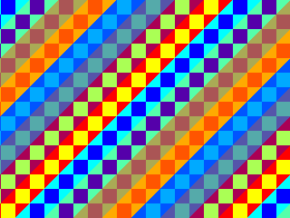

# VGA simulator for Tiny Tapeout projects

[](https://opensource.org/licenses/Apache-2.0) 

Render what your Tiny Tapeout design shows on a VGA monitor as PNG frames, a GIF or an MP4 with
sound, straight from the command line, in seconds. Check a picture without a monitor or an FPGA,
put a moving demo in your README, catch a changed picture in CI, or let an AI agent see what its
Verilog draws.



Along the way it checks the things that make a picture fail on a real monitor: the sync timing,
colour outside the visible area, and state that isn't reset.

## What's in here

- `vga_sim.py` - the command you run: builds your design with Verilator, finds the video mode and
  writes the frames.
- `vga_tb.cpp` - the Verilator testbench that drives the clock and reset and samples the pins.
- `examples/hello/` - a small Tiny Tapeout project with a scrolling pattern and a beep.
- `tests/` - small designs with known output, and the tests that check what the simulator reports.
- `requirements.txt` - the Python packages, for pip. uv reads the same list from `vga_sim.py`.

## Try it

Want to play with a design in your browser, with no install? Open the
[VGA Playground](https://vga-playground.com). Use this tool when you want the frames as files.

You'll need [Verilator](https://verilator.org) 5.006 or newer and Python 3.10 or newer. The
commands below use [uv](https://docs.astral.sh/uv/), which installs the Python packages for you.
Clone the repo and render three frames of the example:

```bash
git clone https://github.com/TinyTapeout/tt-vga-sim
cd tt-vga-sim
uv run vga_sim.py examples/hello -n 3
```

The first run takes about ten seconds to build. You should see:

```text
Timing: hsync 800 clocks per line, pulse 96 clocks (active low); vsync 525 lines per frame, pulse 2 lines (active low)
Mode: 640x480 @ 60 Hz, 25.175 MHz pixel clock, 1 clock per pixel
Saved 3 frames to frames/: frame_0000.png ... frame_0002.png
```

For your own project, pass its folder (the one with `info.yaml`). This renders one second as a GIF:

```bash
uv run path/to/tt-vga-sim/vga_sim.py path/to/your-project -n 60 --gif frames/demo.gif
```

Without uv, run `pip install -r requirements.txt` once, then use `python3 vga_sim.py` wherever
the commands say `uv run vga_sim.py`.

## Options

| Option                        | What it does                                                         |
| ----------------------------- | -------------------------------------------------------------------- |
| `-n 60`                       | Save 60 frames (one second). The default is 1                        |
| `--skip 120`                  | Run 120 frames first, then start saving                              |
| `-o frames`                   | Folder for the PNG files                                             |
| `--gif demo.gif`              | Also save an animated GIF                                            |
| `--video demo.mp4`            | Also save an MP4 with the sound (needs [ffmpeg](https://ffmpeg.org)) |
| `--wav audio.wav`             | Also save the audio on `uio_out[7]`                                  |
| `--compare reference/`        | Compare the frames with reference PNGs and exit with 1 on a change   |
| `--check-reset`               | Run twice from different power-up states and compare the frames      |
| `--ui-in 0x01`, `--uio-in 0`  | Values on the input pins (they stay the same for the whole run)      |
| `-f a.v b.v --top tt_um_name` | Simulate Verilog files directly, without `info.yaml`                 |

Frame 0 is the first picture after reset, the same frame the VGA Playground's exported test calls
`frame0.png`, so its reference images work with `--compare` too.

## What the checks mean

- **Timing** shows the sync signals as measured. The tool knows the standard 640x480, 800x600 and
  1024x768 modes, at one to four clocks per pixel; other timing gives an error.
- **Colour outside the visible area** usually means colour and sync are out of step by a clock or
  two, for example colour from combinational logic next to a registered sync. Register the colour
  outputs to fix it.
- **Reset check failed** means the picture depends on the power-up state. Like a real chip, the
  simulation starts every flip-flop with a random value, so anything that isn't reset shows up here.

The simulation runs your Verilog cycle by cycle and doesn't model the chip's timing. To check the
picture at gate level too, use the cocotb test that the VGA Playground's Export adds to a project.

## Render frames in your project's CI

Add this workflow as `.github/workflows/vga.yaml` to get a GIF and an MP4 of every push as a
download on the workflow run. Once you've committed reference frames to `reference/` (copy them
from `frames/`), add `--compare reference/` to fail the run when the picture changes.

```yaml
name: vga
on: [push, workflow_dispatch]
jobs:
  render:
    runs-on: ubuntu-latest
    steps:
      - uses: actions/checkout@v7
      - run: sudo apt-get update && sudo apt-get install -y verilator ffmpeg
      - uses: astral-sh/setup-uv@v10.3.3
      - run: git clone --depth 1 https://github.com/TinyTapeout/tt-vga-sim /tmp/tt-vga-sim
      - run: uv run /tmp/tt-vga-sim/vga_sim.py . -n 60 --gif frames/demo.gif --video frames/demo.mp4
      - uses: actions/upload-artifact@v7
        if: always()
        with:
          name: vga
          path: frames/
```

## Use it with an AI agent

The [`vga-output` skill](https://github.com/TinyTapeout/skills/tree/main/skills/vga-output) teaches
coding agents (Claude Code, Cursor, Codex and others) to run this tool after each change and act on
what it reports, along with the VGA design habits that held up on real chips.

## Make it yours

The testbench is short on purpose. Copy it into your project and extend it: change `ui_in` from
frame to frame to script a game controller, or record other pins. [AGENTS.md](AGENTS.md) explains
how the pieces fit together.

## CI

On every push, the test workflow simulates the test designs and checks what the tool reports, then
renders a second of the example and uploads the frames, GIF and MP4. A fork needs no setup.

## License

Apache License 2.0, see [LICENSE](LICENSE).
